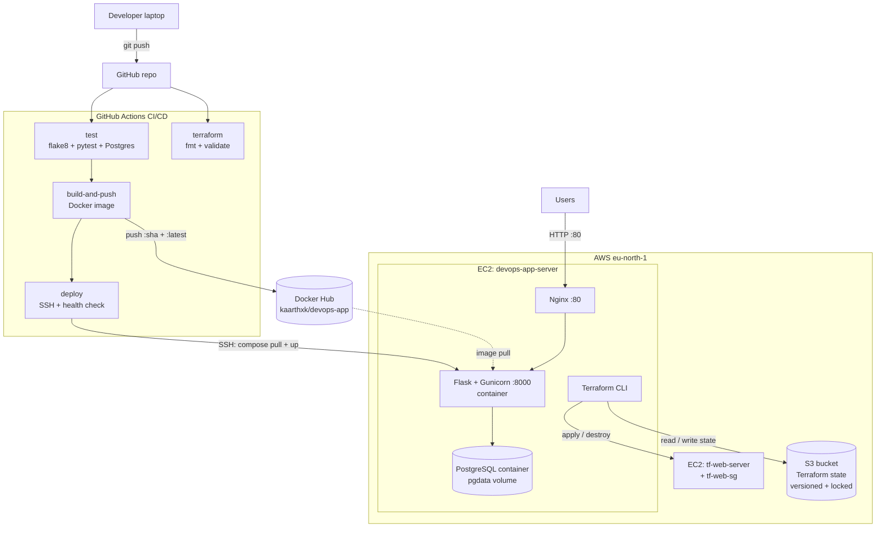

# DevOps Deploy Project


A simple Python Flask + PostgreSQL app, deployed to AWS step by step: first by hand, then automated with Ansible, then containerised with Docker. The app is deliberately small; the focus is on **deployment, automation and operations**.

## Architecture (current)

```
Browser -> AWS Security Group (port 80) -> Nginx (reverse proxy on the EC2 host)
        -> app container (Gunicorn, 127.0.0.1:8000, image kaarthxk/devops-app)
        -> db container (postgres:16-alpine, data in a named volume)
Backup: docker compose exec db pg_dump -> gzip -> S3 (via IAM role, no stored keys)
```

## Tech stack

| Area | Tools |
|---|---|
| Cloud | AWS EC2, EBS, VPC, subnets, Internet Gateway, route tables, security groups, IAM roles, S3 |
| OS | Ubuntu Linux |
| App | Python, Flask, PostgreSQL |
| Containers | Docker, Dockerfile, Docker Compose, Docker Hub |
| Web serving | Nginx, Gunicorn |
| Automation | Ansible (roles, handlers, Vault) |
| Scripting | Bash, cron, AWS CLI |
| Version control | Git, GitHub |

## Run it with Docker Compose

```bash
echo "DB_PASSWORD=change-me" > .env      # git-ignored
docker compose up -d
curl localhost:8000
```

Compose starts PostgreSQL first and waits for its healthcheck, then starts the app. Data lives in a named volume, and both services restart automatically after crashes and reboots.

Image on Docker Hub: [kaarthxk/devops-app](https://hub.docker.com/r/kaarthxk/devops-app)

## Repository structure

```
app.py                     Flask app (/ and /health endpoints)
requirements.txt           Python dependencies
Dockerfile                 python:3.12-slim, layer-cached, Gunicorn --preload
.dockerignore              Keeps venv, .git, keys out of the image
docker-compose.yml         app + db services, volume, healthcheck, restart policy
deploy/
  devops-app.service       systemd unit (Week 1 setup, now retired)
  nginx-devops-app.conf    Nginx reverse proxy to the app container
ansible/                   Roles (common, postgres, app, nginx), Vault-encrypted secrets
scripts/
  backup_db.sh             PostgreSQL backup from the db container to S3
```

## Reliability and security

- Containers restart on failure and after reboot (`restart: unless-stopped`).
- App port bound to `127.0.0.1`; only Nginx is exposed on port 80. The database port is not published at all.
- Secrets come from a git-ignored `.env` (Compose) and Ansible Vault, never from the image or the repo.
- S3 access through an IAM role; Docker Hub login through an access token.
- AWS account protected with MFA, an IAM admin user and a zero-spend budget alert. SSH is limited to my IP.

## Problems I solved

- App died when the terminal closed: moved it to a systemd service.
- Flask development server warning: switched to Gunicorn behind Nginx.
- Site timed out although the app answered locally: missing HTTP rule in the security group.
- cron could not find `aws`: set `PATH` inside the backup script.
- App container crashed on a fresh database: race condition between two Gunicorn workers creating the table; fixed with `--preload`.
- Disk at 73% from Docker images: grew the EBS volume from 8 to 20 GB online with `growpart` and `resize2fs`.

## Roadmap

- [x] Manual deployment on EC2 (systemd, Gunicorn, Nginx)
- [x] Custom VPC, IAM role, S3
- [x] Ansible roles + Vault, automated backups
- [x] Docker, Docker Compose, Docker Hub; containers serving production traffic
- [ ] CI/CD with GitHub Actions
- [ ] Infrastructure as Code with Terraform
- [ ] Kubernetes, Helm, Prometheus + Grafana

## Part 3: CI/CD and Infrastructure as Code

### Architecture



### CI/CD pipeline (GitHub Actions)

| Job | What it does |
| --- | --- |
| test | flake8 lint + pytest against a Postgres service container |
| terraform | `terraform fmt -check`, `init -backend=false`, `validate` |
| build-and-push | Builds the image and pushes `kaarthxk/devops-app:<commit-sha>` and `:latest` to Docker Hub |
| deploy | SSH to EC2 with a dedicated deploy key, pull the new tag, restart the app, check `/health` |

- Secrets live in GitHub Secrets, never in code: `DOCKERHUB_USERNAME`, `DOCKERHUB_TOKEN`, `EC2_HOST`, `EC2_USER`, `EC2_SSH_KEY`.
- Rollback: `APP_TAG=<old-commit-sha> docker compose up -d app`

### Infrastructure as Code (Terraform)

- `terraform-bootstrap/` creates the S3 state bucket once (versioning, encryption, public access blocked, `prevent_destroy`).
- `terraform/` builds a security group (SSH from my IP only, HTTP/HTTPS open) and an Ubuntu 24.04 EC2 instance. `user_data` installs Docker and starts nginx on first boot.
- State is stored in S3 (`web/terraform.tfstate`) with S3 locking (`use_lockfile`).
- AWS access comes from the EC2 instance's IAM role, so there are no access keys.

```bash
cd terraform
terraform init
terraform plan      # preview
terraform apply     # build
terraform destroy   # tear down
```
